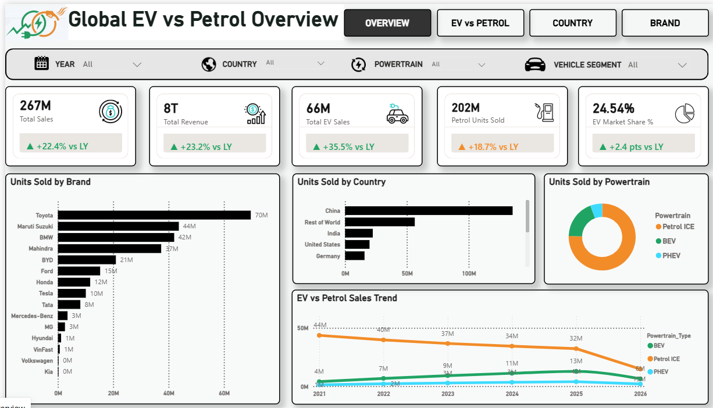
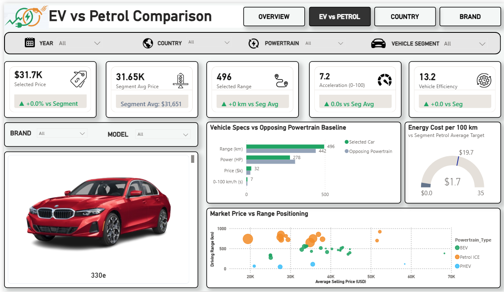
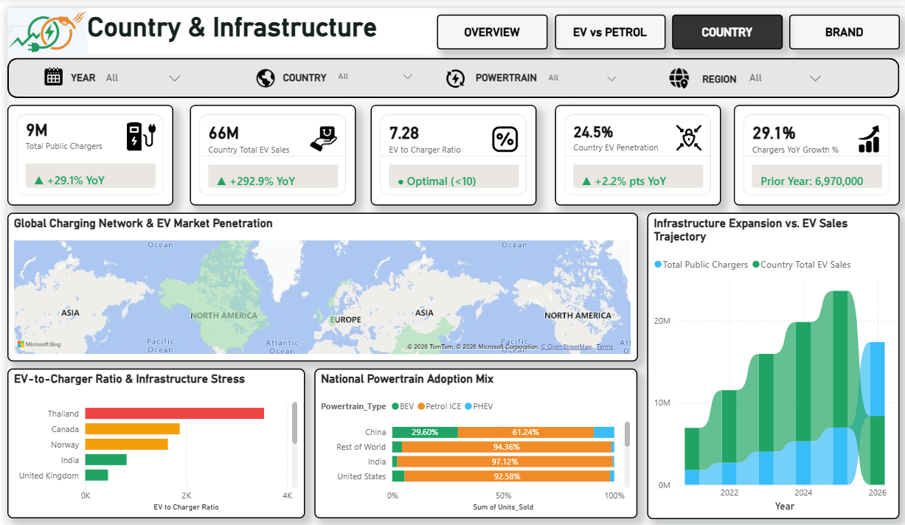
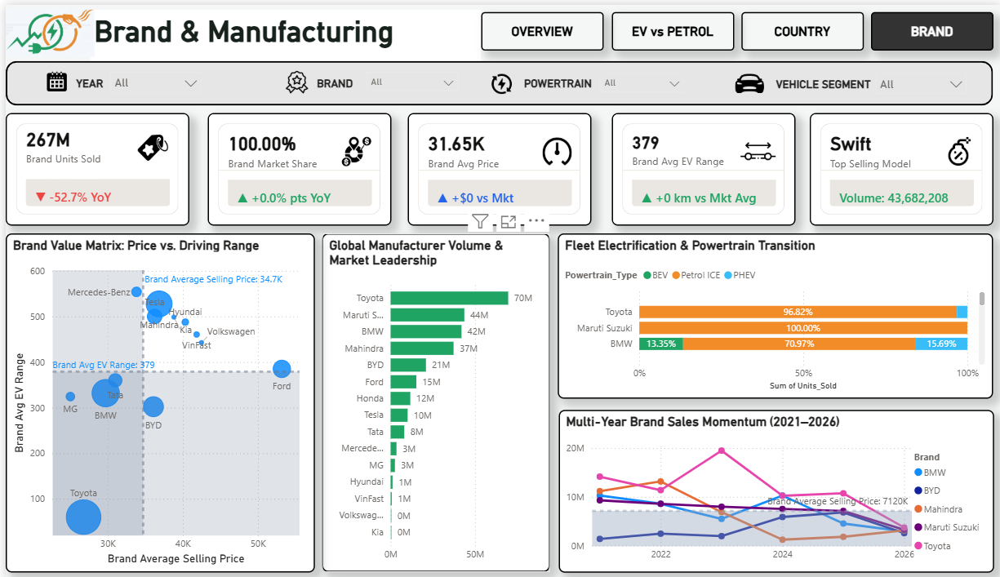

# Global EV vs. Petrol Vehicle Dashboard

## Project Overview
This project presents an interactive Power BI dashboard comparing Electric Vehicles (EVs) and Petrol Vehicles across global markets. It provides insights into vehicle sales, adoption trends, country-level performance, charging infrastructure, and consumer sentiment.

## Tools & Technologies
- Power BI
- Power Query
- DAX
- Data Visualization
- Data Analysis

## Dashboard Pages

### 1. Global Overview
Provides a high-level view of global EV and petrol vehicle markets, highlighting key performance indicators and overall adoption trends.

### 2. EV vs. Petrol Comparison
Compares electric and petrol vehicles based on sales, market share, and adoption patterns.

### 3. Country & Charging Infrastructure
Analyzes country-level vehicle adoption and charging infrastructure to understand the development of EV markets.

### 4. Brand & Adoption
Explores vehicle brand performance, EV adoption trends, and consumer sentiment across different markets.

## Key Insights
- Compared global EV and petrol vehicle adoption trends.
- Analyzed vehicle sales and country-level market performance.
- Explored charging infrastructure across different countries.
- Examined consumer sentiment and vehicle brand adoption.

## Project Purpose
The objective of this project was to practice data analysis, develop interactive visualizations, and gain insights into the global transition from petrol vehicles to electric vehicles.

---

**Project Type:** Power BI Dashboard

**Created using:** Microsoft Power BI